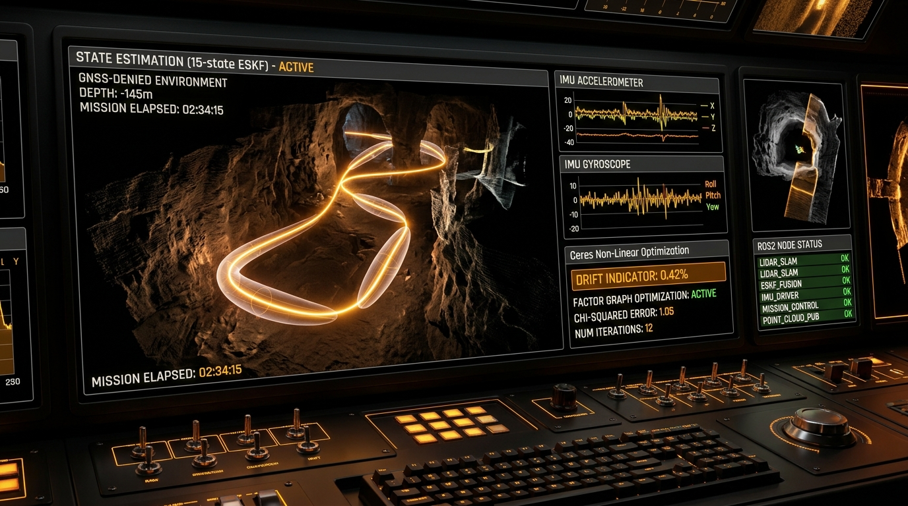
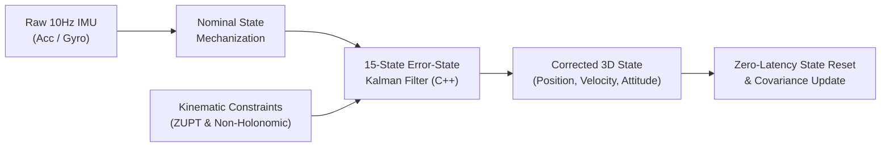
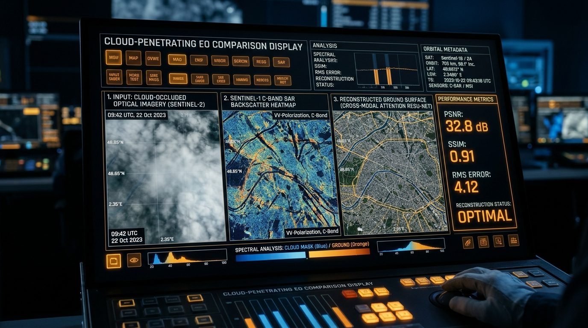
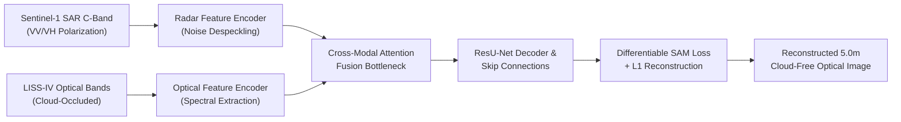
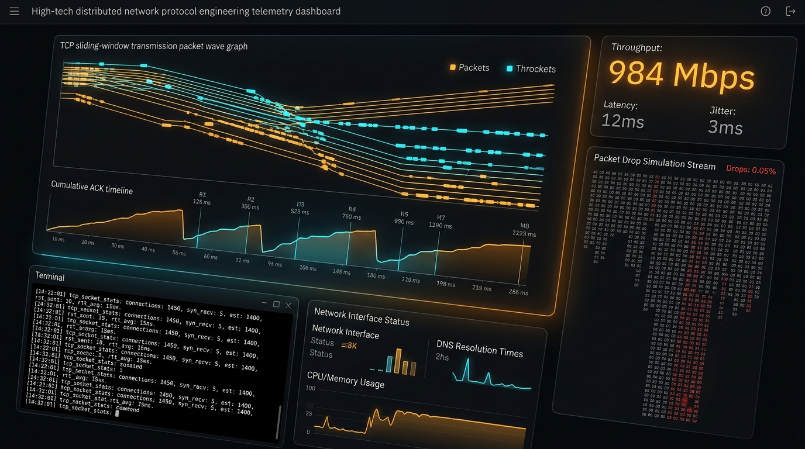
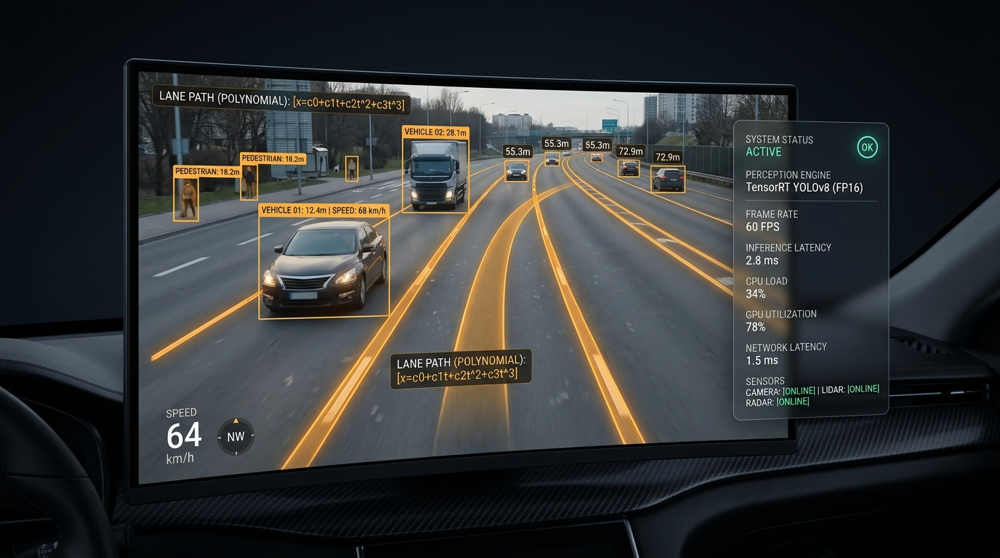
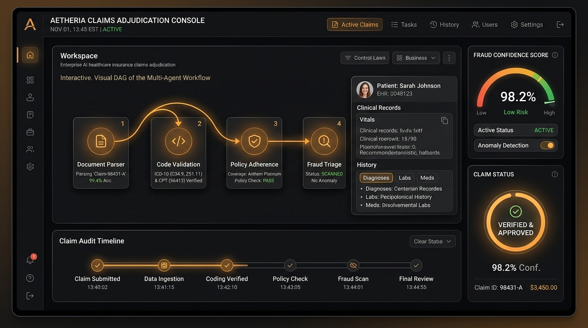
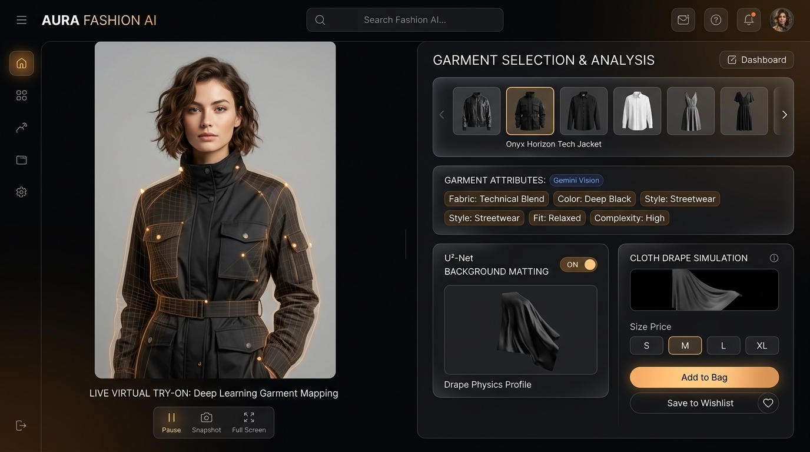

<table border="0" style="border: none;">
  <tr style="border: none;">
    <td width="78%" align="left" style="border: none; padding-left: 20px;">
      <h1>Anirudh Sarve</h1>
      
<strong>Systems Software Engineer | Edge AI & Computer Vision | Distributed Systems</strong>

      
Computer Engineering Undergraduate at Vidyalankar Institute of Technology, Mumbai (CGPA: 8.90 / 10.0)

      

        
        
        
      

    </td>
  </tr>
</table>

  

---

### Technical Specialization

- **State Estimation & Sensor Fusion:** Real-time inertial navigation algorithms coupling high-rate IMU mechanization with a 15-state Error-State Kalman Filter (ESKF) running on embedded ARM platforms under total GNSS signal outages.
- **Computer Vision & Generative AI:** Cross-modal optical and Synthetic Aperture Radar (SAR) translation networks with custom differentiable Spectral Angle Mapper (SAM) loss, reaching 32.09 dB PSNR on satellite imagery.
- **Systems & Low-Latency Runtimes:** In-browser client-side neural inference via WebAssembly and WebGL (<3.5s latency, zero recurring server GPU egress cost), atomic distributed locks in Upstash Redis, and user-space TCP/IP protocol stacks.

---

### Engineering Toolkit

| Domain | Frameworks, Languages, and Infrastructure |
| :--- | :--- |
| **Languages** | C++ (C++17/20), Python, TypeScript, JavaScript (Node.js), SQL, Go, Rust (Foundations) |
| **Systems & Cloud** | Linux/POSIX, WebAssembly (WASM), WebGL, Docker, WebSockets, gRPC, Microservices, CI/CD, AWS, GCP |
| **AI, Perception & Runtimes** | PyTorch, ONNX Runtime, CUDA / TensorRT, OpenCV, 15-State ESKF, Sensor Fusion, ResU-Net, Scikit-learn |
| **Data & Storage** | PostgreSQL, Upstash Redis (Atomic Distributed Locks), MongoDB (2dsphere), Qdrant Vector DB, SQLite FTS5 |

---

### Key Engineering Systems & Architecture

#### 1. Neural-Inertial Dead-Reckoning Engine with 15-State ESKF
**Repository:** [github.com/anisarve2006/Dead-Reckoning-Model](https://github.com/anisarve2006/Dead-Reckoning-Model)  
**Affiliation:** Lead AI Architect, Smart India Hackathon (ISRO Problem Statement 26168)  
**Technologies:** C++17, PyTorch, 15-State ESKF, IMU Mechanization, ARM Cortex-A

Real-time odometry and vehicular dead-reckoning navigation architecture designed to sustain localization accuracy during complete GNSS/GPS blackouts. Executes raw 10 Hz IMU kinematic integration coupled with zero-velocity updates (ZUPT) and non-holonomic velocity constraints in C++ at sub-3.0 ms CPU execution latency per cycle on embedded ECUs.

<!-- 

  

 -->

---

#### 2. Multimodal Optical-SAR Satellite Cloud Removal ResU-Net
**Repository:** [github.com/anisarve2006/Temporal-Cloud-Removal](https://github.com/anisarve2006/Temporal-Cloud-Removal)  
**Application:** ISRO Resourcesat-2/2A LISS-IV & Sentinel-1 C-Band Radar Fusion  
**Technologies:** PyTorch, ResU-Net, Cross-Modal Attention, Sentinel-1 SAR C-Band

Deep generative reconstruction network bridging radar backscatter and high-resolution (5.0 m) optical spectral bands over persistently cloud-covered terrain. Engineered with a custom differentiable Spectral Angle Mapper (SAM) loss function, achieving **32.09 dB PSNR**, **0.7167 SSIM**, and a strict **6.17 deg SAM spectral angle** on validation scenes across the Assam river corridor.

<!-- 

  

 -->

---

#### 3. ProtoLink: Custom User-Space TCP/IP Protocol Stack & Dissector
**Repository:** [github.com/anisarve2006/custom-tcp-ip-stack](https://github.com/anisarve2006/custom-tcp-ip-stack)  
**Technologies:** C++, Systems Programming, Raw Sockets, Network Protocols, State Machines

From-scratch implementation of core Internet protocol suite layers in user space. Manages Ethernet frame encapsulation, ARP resolution tables, IPv4 fragmentation and reassembly, ICMP error handlers, and sliding-window TCP transmission state machines with custom packet inspection and transmission visualization.

<!-- 

  

 -->

---

#### 4. NAViGO: Autonomous Mobile Robot Perception & Visual SLAM System
**Repository:** [github.com/anisarve2006/Dead-Reckoning-Model](https://github.com/anisarve2006/Dead-Reckoning-Model)  
**Technologies:** C++, ROS 2, OpenCV, Point Cloud Processing, Embedded Computing

Perception and local navigation stack for autonomous rovers operating across unstructured environments. Integrates real-time feature extraction, visual odometry, local costmap generation, and obstacle avoidance pathways calculated via dynamic window trajectory evaluation.

<!-- 

  

 -->

---

#### 5. StandIQ: Autonomous Indian Standards Intelligence & Compliance Engine
**Repository:** [github.com/anisarve2006/StandIQ](https://github.com/anisarve2006/StandIQ)  
**Affiliation:** Smart India Hackathon (SIH 2026 Problem Statement 108)  
**Technologies:** FastAPI, SQLite FTS5, ONNX Runtime, PaddleOCR, Reciprocal Rank Fusion

Neuro-symbolic compliance search engine built to parse, index, and cross-reference tender requirements against 19,423 Bureau of Indian Standards (BIS) regulatory documents. Combines BM25 lexical ranking, regex token filters, and dense vector embeddings via Reciprocal Rank Fusion, integrated with OCR extraction maintaining 99.28% recognition accuracy on multi-column tender schedules.

<!-- 

  

 -->

---

#### 6. Client-Side Edge Neural Vision Runtime & In-Browser Matting Engine
**Technologies:** WebAssembly (WASM), WebGL, U²-Net, ONNX Runtime Web, TypeScript

Zero-backend client-side computer vision runtime processing high-precision photo-matting and human segmentation directly inside the user's browser in sub-3.5 seconds. Eliminates external cloud GPU inference latency and recurring egress costs through WebGL hardware acceleration.

<!-- 

  

 -->

### GitHub Activity and Contribution Metrics

  
  

  

---

  <strong>Contact and Professional Links:</strong> 
  <a href="https://anirudh-sarve.me">Portfolio</a> | 
  <a href="https://www.linkedin.com/in/anirudh-sarve-2130a724a">LinkedIn</a> | 
  <a href="mailto:anisarve2006@gmail.com">Email</a>

